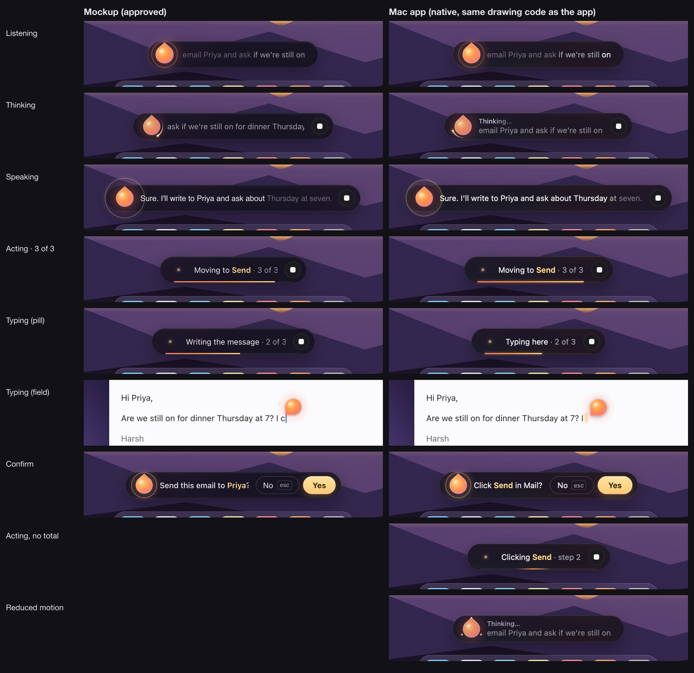

# Companion and caption pill: the Mac app against the approved mockup

*Sep 29, 2026. Self-improve task after #106, and a polish pass after #108 (see "Polish pass" below).* The mockup is
`_research/echo-companion-ui-plan/mockup.html` (next to the Echo folder; the spec is `plan.md`
there). This page records what differed between it and the Mac app, and what was done about it.

## How the comparison was made

- **Mockup:** opened in headless Chrome at 1440×900 points, 2× pixels. Each state was triggered
  with the mockup's own keys (1–8) and the pill area cropped (500×110 pt around the pill).
- **Mac app:** `scripts/render-companion.sh BACKGROUND.png OUT_DIR` compiles the app's own drawing
  code (`PillArt.swift`, `Companion.swift`, `PointMath.swift`) with `macos/Tests/Render/main.swift`
  and draws each state over the mockup's desktop (captured with the mockup's pill and orb hidden),
  with the same blur and crop. The pixels come from the same functions the app calls every frame.
- **Not done:** a screen capture of the running Echo.app. The live app runs from the live folder
  and wasn't touched (no rebuild, no requests to it), and a screen capture would have included
  whatever else was on screen. After the merge and rebuild, the check is the manual test at the end.
- **Motion** was compared from the numbers: the mockup's constants were read from its script and
  the app's from `CompanionMath`; the glide, spring and docking rules have tests in
  `macos/Tests/main.swift` (run by `test/macapp.test.js`).

## Differences found, and what changed

| Area | Mockup | Mac app before (task #106) | Now |
|---|---|---|---|
| Caption bar shape | One 44 pt pill, fully round, 220–560 pt wide hugging its text (max 46% of the screen) | A fixed 660×88 pt card with three lines and a 20 pt corner | The mockup's pill: 44 pt, radius 22, width hugs the text (`PillMath.width`), animates over 340 ms with ease-glide |
| Glass | Graphite `#0f0f12` at 78% over blur 26 + saturate 160%, 1 pt `#26262c`/60% border, 1 pt top highlight, shadow 0 10 30 at 35% | HUD blur with a 55% tint, a coral border and a coral glow | Exactly the mockup's layers (`PillArt.draw`), no coral edge |
| Layout | Companion slot 28 pt at the left (16 pt in), text, Stop at the right (8 pt in) | Status dot, three stacked text fields, a system "Stop" push button | Slot, text column, round 28 pt graphite Stop with a 9 pt rounded square; honey ring on hover; presses in to 95% |
| Where it sits | 22 pt above the Dock | 28 pt above the visible frame | 18 pt above the visible frame (≈22 pt to the Dock's glass), 20 pt with no Dock; lifts above a target it would cover, or docks under the menu bar |
| Text | One line: your words (ink-400, older words at 55%, newest brightest, last 8 words) or Echo's line (ink-100) | "You: …" line, Echo line in 15 pt medium, amber status | Same colours and 8-word window. Echo's line is SF Pro 13 regular (what the approved mockup shows in Chrome) |
| Status ("what I'm doing") | "Moving to **Send**" replaces the words | A separate amber 11 pt line | A small 11 pt line *over* your or Echo's words when both exist (the task asks for both), still inside 44 pt; one line otherwise. The doing line comes from the app itself ("Clicking **Send**", label in honey) |
| Line changes | Fade in rising 4 pt over 220 ms; newest word fades in | Instant | Same: cross-fade with a 4 pt rise; newest word fades in over 250 ms |
| Thinking | Muted words, "Still thinking…" shimmer after 3 s | "Thinking…" text | "Thinking…" with the mockup's shimmer at once, over your muted words |
| Long lines | Scroll in step with speech | Cut at the start | Echo's long line glides along at speaking pace with soft edges; your words keep the newest |
| Confirmations | Question + ghost "No esc" + honey "Yes" | "Waiting for you to confirm" | The question ("Click **Send** in Mail?") with the mockup's No/Yes; they answer the same card as the window (`captionConfirm`). Without a question yet, "Waiting for you to confirm" in honey |
| Show / hide | Fade + rise 8 pt, 220 ms; hides 3.5 s after it goes quiet | Fade 300 ms; hides after 2.5 s | Fade + rise 8 pt, 220 ms; hides 3.5 s after quiet |
| Companion home | Docked in the pill's slot while listening, thinking, speaking, confirming; a faint honey dot stays in the slot while it's out | Only appeared when pointing, near the target, then faded | Docks in the slot whenever the pill is up (appears there on a soft spring, 0.6 → 1). The honey dot shows while it's out |
| Choreography | Flies out to act, returns home to confirm or when done | Pointed, then faded after 6.5 s | Flies out on each step; comes home when Echo speaks or listens (not mid-click, not in its first 0.8 s there), 1.8 s after a finished step's sparkle, or when you talk after a "look here" point. A "look here" stays while Echo talks about it |
| Resting look in the pill | Idle: 90% size, 72% opacity, glow 20%, 5.5 s breath | (no resting state) | The mockup's idle, acting and confirm presets |
| Glide | Quadratic arc bowed 12%, ease-glide, 260 ms + 0.35 ms/pt (≤ 700 ms), 14-dot trail | Same | Same timing and arc, plus: a soft launch (no jolt from rest), and a new target mid-flight carries the current speed (no kink). Docking follows the pill with a critically damped spring |
| Frame rate | Browser rAF | A 60 Hz `Timer` (drifts against the display) | `FrameClock`: the display's own link, up to 120 Hz on ProMotion; stops when nothing shows. The pill redraws only while something in it moves |
| Before a click | Park, outline on, a beat, pulse + ring + outline ping, then the click | Pulse at most 150 ms after arrival, click 0.5 s after the request | Highlight fades in faintly as the orb approaches and fully on arrival (with a 7% honey wash); 180 ms after arrival: pulse, ring, ping and three small glints thrown at the target; the click follows 360 ms later (`aboutToAct` returns the wait) |
| Label near target | None (the verb goes in the pill) | A floating label bubble | In the pill when it's up; the bubble only when there's no pill (Echo's window in front) |
| Mouse | Parked orb steps 16 pt aside | Same | Same, and the pill dims to 40% (with its docked orb) while your mouse is over it, so it never hides what you're working on |
| Sizes | Small 22 / Medium 28 / Large 34, default Medium | Small 28 / Medium 32, default Small | Small 22 / Medium 28 / Large 34, default Medium. Old settings carry over (old small → Medium, old medium → Large), so nobody's orb shrinks |
| Reduced motion | Toggle: no travel (fade out/in 150 ms), no trail, ripples, swirl or sparkle | Followed macOS only | Settings → Screen → Reduce motion: Same as macOS / On / Off. Applies to the orb and the pill (no rise, no shimmer, no scroll) |

## Polish pass (after #108)

The image above was re-rendered for this pass. The mockup side is a fresh capture of `mockup.html`
in headless Chrome (1440×900 pt at 2×, driven over the DevTools protocol, each state started with the
mockup's own functions; its desktop captured with the pill, orb and caret hidden). The Mac side is
`scripts/render-companion.sh`, now with an optional typing background and caret position, which
also draws Echo typing in the mockup's mail window.

| Gap | Now |
|---|---|
| Acting: "Moving to **Send** · 3 of 3" and the sunset progress line | The assistant may guess a request's step count (`steps_total` on its first step); the pill shows "3 of 3" in muted grey after what Echo is doing and the mockup's 2 pt coral → amber → honey line 22 pt in from each end, with a soft amber glow. It fills to 0.2, 0.53, 0.87 for steps 1–3 of 3 (the mockup's 0.2, 0.55, 0.85) and fully when the last is done. A guess that runs short grows ("4 of 4", never "4 of 3"). With no guess: "step 2" from the second step, and a short run of light drifts along the line instead of a made-up number |
| Speaking: the soft halo ring around the orb | A honey ring at 2.1× the orb's radius with a soft glow, easing in over 220 ms when Echo starts talking, breathing slightly and brightening on her voice's peaks (the ripples still roll out on top). Reduce motion: it stays put and only brightens |
| Speaking: upcoming words dimmed, fading in as spoken | Echo's words are timed from her voice (ElevenLabs' real timings, else an estimate over the real audio length, as the chat's karaoke does; the browser voice gets an estimate at her pace) and sent to the pill on the wall clock. Upcoming words wait at 38% (the mockup's), each fades up over 180 ms as it's said with a brief touch of honey, and never goes backwards. A long line glides to keep the word she's saying in view (it used to scroll on a guess) |
| Typing (new) | Character by character at a natural pace, the drop bobbing just above and right of the caret (the mockup's placement), a glowing honey caret that breathes instead of blinking, and a small glint on each new character. See docs/computer-use.md |

## Left as it is, on purpose

- **Aurora and Mandala looks, quiet mode, the little delight moments:** not part of this task. The
  look setting still only offers the sunset drop from #106.
- **Ripples in the still images:** the speaking ripple appears on voice peaks, so a still frame may
  or may not catch one. It's the same drawing code as the mockup's.

## Manual test after the merge (needs `npm run build-app`)

1. Hide Echo's window and hold push-to-talk: the pill rises in at the bottom centre with the orb
   in its slot, breathing, and your words appear (newest brightest).
2. Let go: "Thinking…" shimmers and a comet circles the orb; then Echo's line shows while the orb
   ripples. A long line glides along as she speaks.
3. With computer use on, ask for something with a click: the orb leaves the pill (a faint dot stays),
   glides on an arc to the target, the target glows faintly then fully, the orb pulses and glints,
   the click happens, a tiny sparkle, and it glides home. The status reads "Clicking **…**".
4. Ask for something that needs a yes ("send it"): the orb comes home and breathes in honey, the
   target stays lit, the pill asks with **No** and **Yes**. Click Yes: the app you're in keeps focus.
5. Move the mouse over the pill: it dims. Over Stop: Stop gets a honey ring and one click stops Echo.
6. Full-screen app: all of the above shows over it. Settings → Screen: try Small and Large, and
   Reduce motion On (no gliding: the orb fades out and in).
7. Polish pass: let Echo speak a long answer: the orb gets a soft halo and her words light up as
   she says them, the rest waiting faintly. Ask her to "write a note in Notes saying …" on screen:
   the pill shows "Typing here · 2 of 3" with the progress line, and the text goes in letter by
   letter with the orb bobbing by the caret. Try the same in Chrome (a search box), Gmail (a
   compose body) and Messages. Reduce motion On: the text appears at once.
