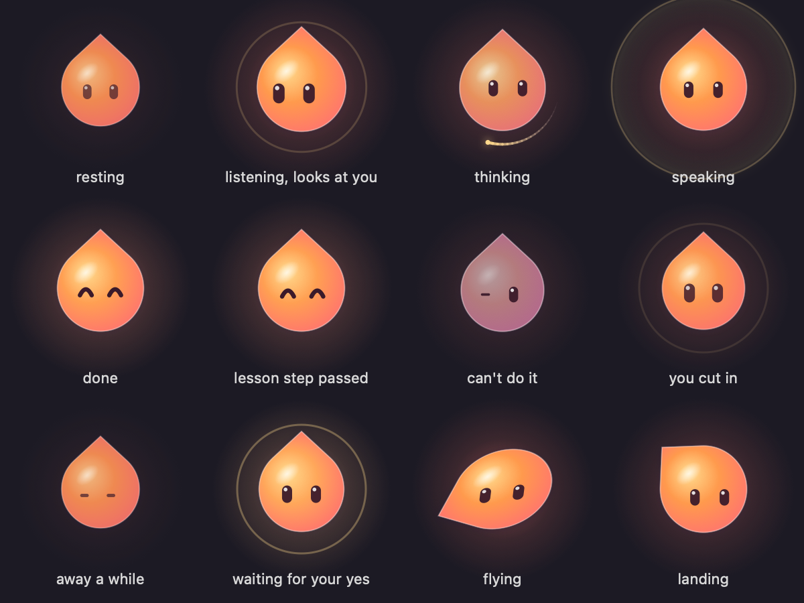
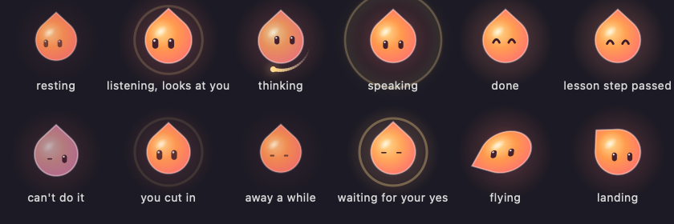

# The companion's personality

The orb has eyes and body language, so it reads as someone beside you rather than a light. Every
reaction is tied to something that really happened in Echo; nothing is random except the timing of
blinks and idle glances.

At its real size (28 pt, 2×):

## Eyes (Companion.swift `drawEyes`, PointMath.swift `EyeMath`)

- Two small dusk-ink eyes with a glint, level whichever way the drop points.
- **Blinks** every 2.2 to 5.8 s, one in four a quick double blink.
- **Gaze** (`Pointer.swift gazeTarget`): where it's going while it glides; the target while it points
  or acts; the caret while it types; your mouse while it listens or waits for your yes; up and away
  while thinking; otherwise a small glance now and then. Up to 24% of the radius sideways, 16% up or down.
- **Expressions** (`EyeMath.look`): wide while listening, wider when you cut in; happy arcs (^ ^)
  when a step worked, a lesson step passed or a lesson finished; the left eye flat when it
  couldn't do something; half shut when dozing.
- While it rests (the frame loop stops for near-zero CPU), Core Animation draws the eyes and plays
  the blinks (`addRestEyes`, `EyeMath.restBlinks`). After three quiet minutes it dozes: eyes droop
  until anything happens.
- Settings → Companion orb → Eyes (on by default). Off: the plain drop, as before.

## Body language

| Moment | What it does |
|---|---|
| Gliding to a target | Stretches along its flight (up to 18%, `EyeMath.stretch`) and looks ahead |
| Landing | A squash from its bottom and a small rebound (0.42 s, `EyeMath.land`) |
| A lesson step passed | A quick nod, happy eyes, two glints (`nod`, page `lesson_card` → moment `proud`) |
| The lesson finished | A bigger burst of nine stars and happy eyes (`celebrate`, moment `celebrate`) |
| You talk over Echo | A startled pop, then wide eyes (`startle`, moment `surprised`) |
| A step worked / failed | Sparkles / a soft wobble, as before, now with happy or puzzled eyes |

Moments reach the app as `{ type: 'companion', moment }` (ScreenBridge.swift → `PointerOverlay.moment`).
Reduced motion keeps blinks and expressions but drops glances, stretch, squash, nods and pops.
