# Minimal overlays: before and after

Echo's on-screen signals in the Mac app, made small so they never take room from you. Images are
rendered with `scripts/render-overlays.sh docs/screenshots/overlays` (the app's own pill and orb
drawing, plus the edge line and chip numbers from `EdgeMath` and `ChipMath`) over a made-up desktop.

| | Before | After |
|---|---|---|
| Whole screen | 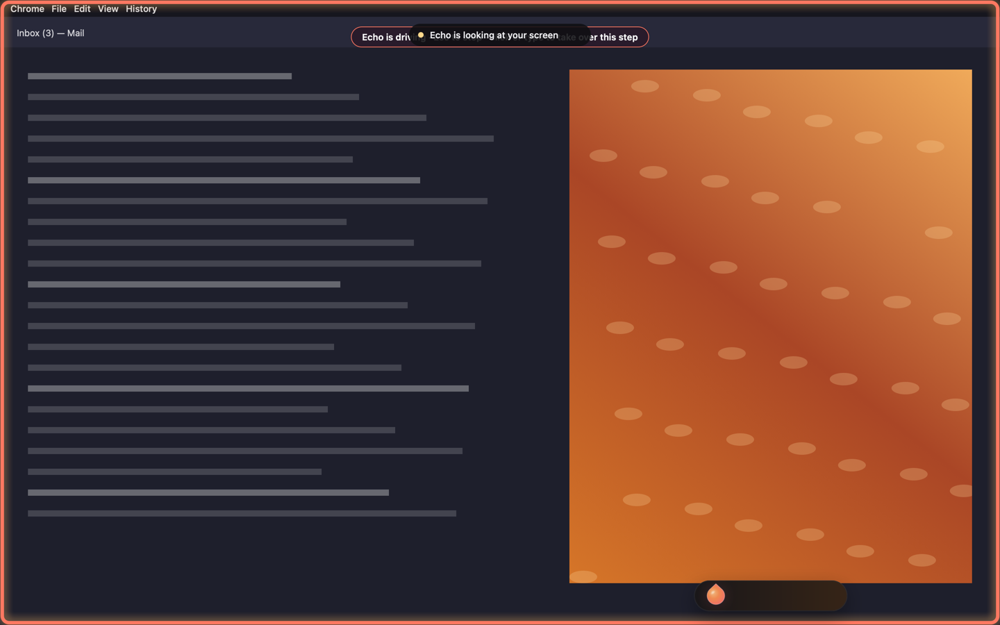 | 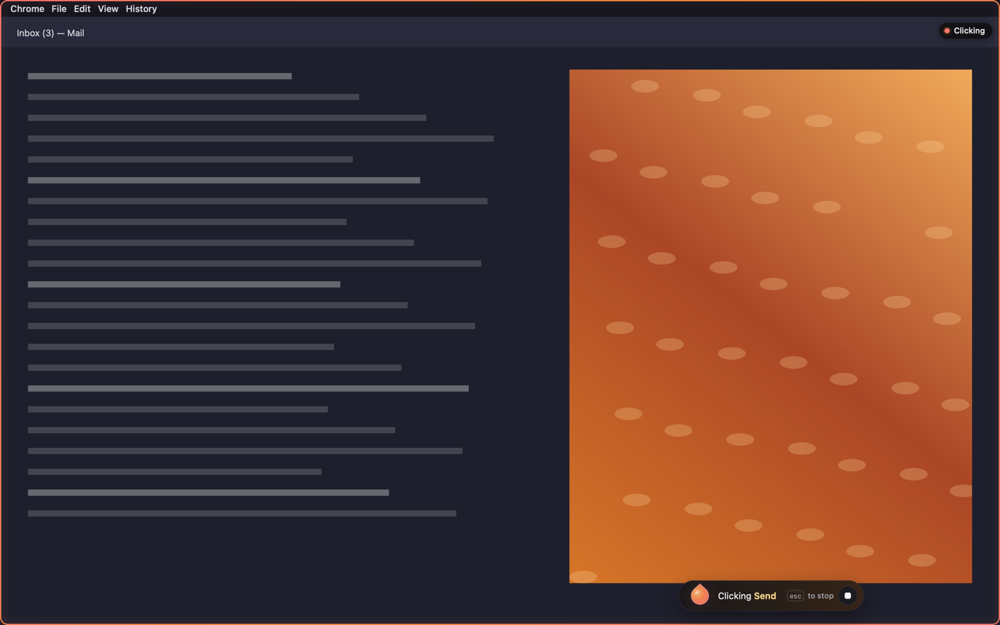 |
| Top of the screen | 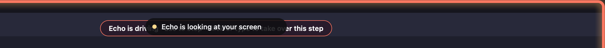 | 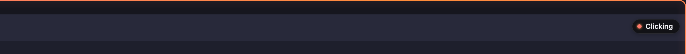 |
| Caption pill, nothing to say | 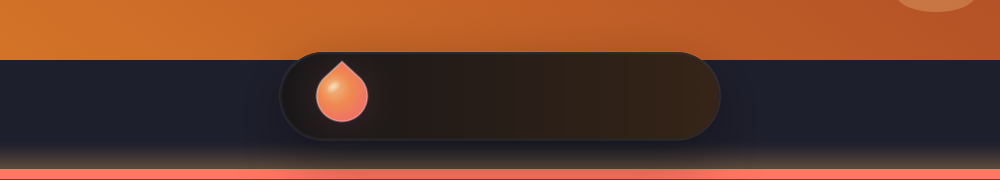 | 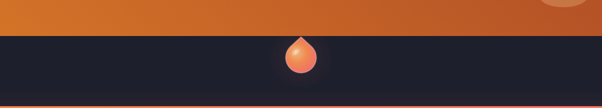 |
| A few seconds into a drive | | 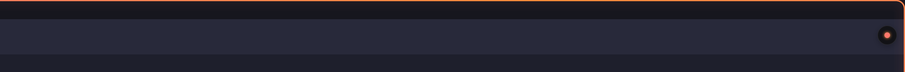 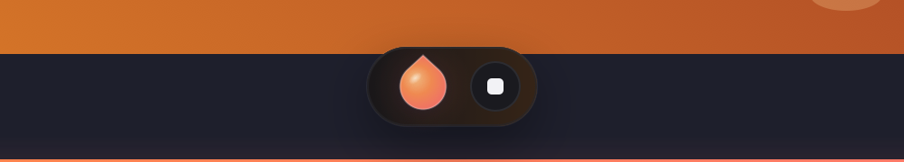 |

What changed (macos/Sources/Overlays.swift, Caption.swift, PillArt.swift, PointMath.swift):

1. **No banner.** The "Echo is driving · Esc to stop · click or type to take over this step" pill is
   gone. "esc to stop" shows beside Stop in the caption pill for the first 4 seconds of a drive,
   then fades (`CaptionBar.flashHint`).
2. **One status chip.** `StatusChip` is a single 24 pt graphite chip in the top-right corner, under
   the menu bar. It shows one state (`ChipMath.state`: what Echo is doing, else Looking, else
   Driving), crossfades between states, and shrinks to a glowing dot 3.5 s after the last change.
   The separate "Echo is looking at your screen" pill is gone, so nothing stacks. In Echo's own
   window the page's look pill hides while the driving banner is up.
3. **The caption pill collapses.** With no text its glass fades away and it closes around the orb
   (`PillMath.width` with no text); while Echo drives it's just the orb and Stop. It opens again
   smoothly when there are words.
4. **Edge glow.** `EdgeGlow` draws a 1.5 pt coral → tangerine line on the screen's outermost pixels
   (it never covers content), with a soft coral glow that breathes over 3.6 s. With Reduce motion
   the glow holds still. It shows while Echo looks or drives, and fades in and out.

Everything stays click-through, never takes focus, and floats over full-screen apps. Rebuild the Mac
app after merging (`npm run build-app`).

## Fix: a caption pill that never showed words (task 118)

After this pass was installed, the caption pill still showed as a long, empty tinted bar: just the
orb and the blurred screen behind it, never your words, Echo's line or a status.

**Root cause.** The pill's drawing (graphite fill, border, words, Stop) was a bare `CALayer` added
straight to the root view's layer, next to the `NSVisualEffectView` blur. AppKit manages the layers
of layer-backed views and may reorder or drop sublayers it doesn't own, so in the running app the
drawing ended up under (or without) the blur. Pixels in the reported screenshots prove it: inside
the pill the background is only about 24% darker (the blur's tint), where the 78% graphite fill
alone would darken it about 70%. Fresh test launches happened to keep the order, which is why
it didn't show in renders. The page and bridge were fine: captions reached the app, and the pill
even sized itself to the words; they just weren't visible.

What changed:

1. **The drawing is a real subview above the glass** (`PillView` in Caption.swift, placed
   `.above` the blur), so AppKit keeps it on top and handles its scale. It never takes clicks.
2. **An idle first show closes around the orb.** With nothing to say on the very first show, the
   content equalled the empty start, so the size was never worked out and the pill sat as an empty
   220 pt bar with full glass. `show()` now always recomputes (`recompose(force: true)`).
3. **Blank text is no text.** Status, words, the question and "doing" lines are trimmed of spaces
   and newlines (`PillMath.clean`), so whitespace never holds the pill open.
4. **The orb sits concentric in the pill's round end.** It docks at the centre of the left half
   circle (pill radius 22 = orb radius + even padding, top, bottom and left), and Stop at the centre
   of the right one. Closed, the pill is a circle around the orb (orb and Stop: 80 pt).
5. **The edge glow follows the display's corners.** It's a rounded rectangle just inside the
   edge: about 11 pt corners on a MacBook's built-in screen with a notch, 6 pt on older built-in
   screens, square on external monitors. On a notched screen the top line stops 6 pt either side of
   the notch (from `NSScreen.auxiliaryTopLeftArea` / `auxiliaryTopRightArea`), with round ends.

Checked in a built app on the test port (4799), driven through each state:

| | |
|---|---|
| Unfixed, first show with nothing to say | 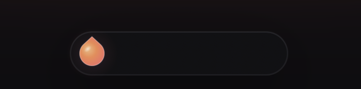 |
| Your words | 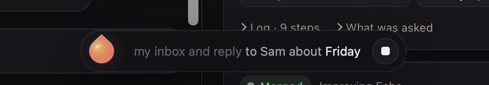 |
| Echo's line | 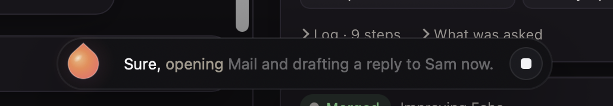 |
| Driving, no words: orb and Stop | 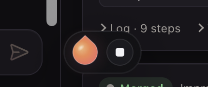 |
| Nothing to say: just the orb | 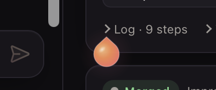 |
| Edge glow: top corner, notch, bottom corner | 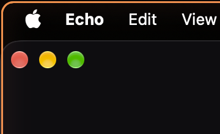 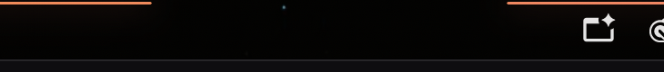 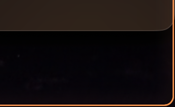 |

Rebuild and reinstall the Mac app after merging (`npm run build-app`, same signing identity).
